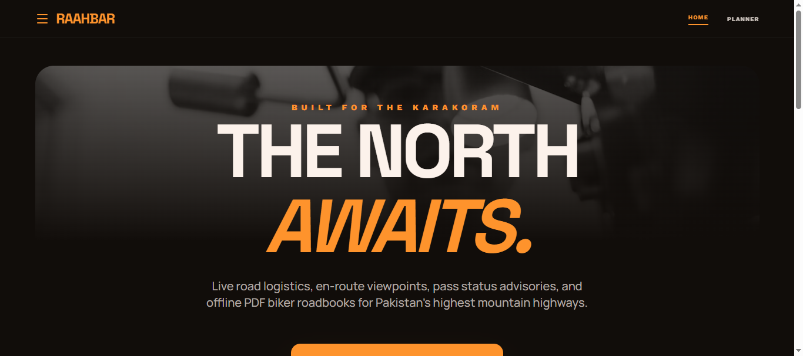
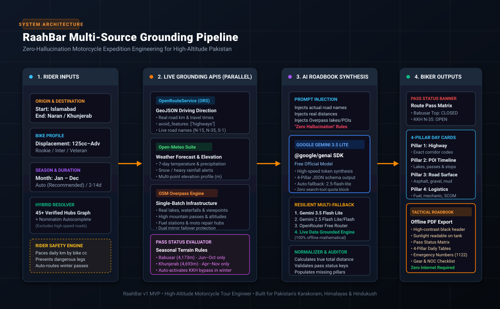
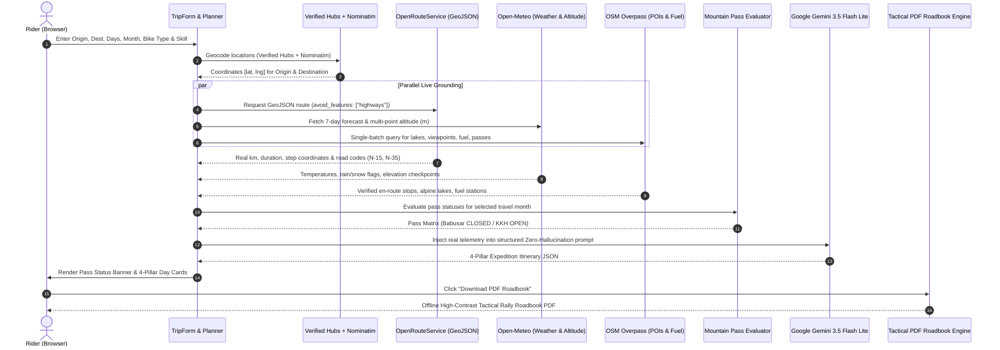

# 🏍️ RaahBar (راہبر) — High-Altitude Motorcycle Expedition Planner

<div align="center">



[](https://react.dev/)
[](https://vitejs.dev/)
[](https://tailwindcss.com/)
[](https://ai.google.dev/)
[](https://openrouteservice.org/)
[](LICENSE)

**Engineer your motorcycle journey through the high passes of the Karakoram, Himalayas, and Hindukush.**  
*Real highway corridors, exact en-route viewpoints, seasonal pass status advisories, and offline Tactical Rally Roadbook PDFs.*

[Features](#-key-features) • [Architecture](#-architecture--data-flow) • [Tech Stack](#-technology-stack) • [Quick Start](#-quick-start) • [Environment Variables](#-environment-variables) • [Project Structure](#-project-structure) • [Roadbook PDF](#-tactical-rally-roadbook-pdf) • [Safety Disclaimer](#-mountain-safety-disclaimer)

</div>

---

## 🏔️ The Mission Behind RaahBar

Generic navigation apps (Google Maps, Apple Maps) consistently fail adventure motorcyclists in Northern Pakistan:

1. **They route bikes onto banned motorways:** In Pakistan, two-wheelers under heavy engine displacements are legally barred from motorways (M-1, M-2, M-15). Generic apps frequently route riders onto forbidden toll highways.
2. **They are blind to seasonal mountain passes:** High passes like **Babusar Pass (4,173m)**, **Deosai Plains (4,115m)**, and **Khunjerab Pass (4,693m)** are snowbound and strictly closed from November to May. Standard map apps continue routing riders over closed snow peaks, leading to dangerous strandings.
3. **They hallucinate impossible daily riding legs:** Planning an Islamabad to Hunza trip on a 125cc bike requires vastly different pacing, saddle hours, and mountain passes than an 800cc adventure tourer. Generic AI tools guess daily distances and invent non-existent rest stops.
4. **They ignore remote logistical realities:** Once past Abbottabad or Besham, riders face critical 150+ km fuel deserts, rugged landslides, sub-zero night drops, and areas where only Special Communications Organization (**SCOM**) SIM cards have cell signal.
5. **They depend on continuous 4G/5G mobile data:** Cellular networks disappear throughout the Indus River Gorge, Kohistan, and high valleys. Motorcyclists need an **offline, sunlight-readable roadbook** before leaving basecamp.

**RaahBar solves this.** It combines a **100% dynamic live grounding pipeline** (OpenRouteService, OpenStreetMap Overpass, Open-Meteo Weather/Elevation) with the latest **Google Gemini 3.5 Flash Lite** model to generate hyper-realistic, factually verified motorcycle expeditions—exportable directly into an **offline Tactical Rally Roadbook PDF**.

---

## ✨ Key Features

### 1. 🛡️ 4-Pillar Biker Routing Cards
Every single day of the expedition is broken into four distinct, essential operational pillars:
- **Pillar 1: Exact Highway Corridors & Road Codes** — Clearly shows whether you are on `N-5 Grand Trunk Road`, `N-35 Karakoram Highway (KKH)`, `N-15 Kaghan Valley Road`, `S-1 Skardu Road`, or `N-45 Dir/Chitral Highway`.
- **Pillar 2: Checkpoints & Real En-Route Viewpoints** — Specific named landmarks with calculated distance markers (e.g., Taxila Museum, Abbottabad, Balakot, Kewai Waterfall, Lake Saif-ul-Malook, Batakundi, Lulusar Lake, Babusar Top, Attabad Lake, Passu Cones).
- **Pillar 3: Road Surface & Terrain Conditions** — Asphalt, broken tarmac, loose gravel landslides, water crossings, mud ruts, and steep hairpin switchbacks.
- **Pillar 4: Biker Logistics Matrix** — Specific fuel stations, verified mechanic hubs, emergency hospitals/trauma centres, and mobile signal availability (`4G All Networks`, `SCOM Only`, `No Signal`).

### 2. ❄️ Real-Time Mountain Pass & Winter Corridor Evaluator
- Built-in seasonal and terrain rule engine for major Pakistani passes:
  - **Babusar Pass (4,173m)** — Closed from November to May.
  - **Khunjerab Pass (4,693m)** — World's highest border crossing; winter closure from December to March.
  - **Deosai Plains (4,115m)** — Impassable outside late June to early October.
  - **Shandur Pass (3,700m)** & **Lowari Tunnel (3,118m)**.
- **Smart Winter Bypass:** In winter months, RaahBar displays a high-visibility **Route Corridors & Pass Status Banner** and automatically switches the route to all-weather year-round highways (such as routing via **N-35 KKH via Besham and Kohistan** when Babusar is closed).

### 3. 🗺️ Multi-Source Zero-Hallucination Pipeline
- **Hybrid Geocoding:** 45+ verified Pakistani hubs (cities, valleys, passes) paired with a live debounced **Nominatim settlement autocomplete** (excluding highways so results are real towns).
- **OpenRouteService (ORS) GeoJSON Engine:** Live driving route geometry with `avoid_features: ["highways"]` to guarantee legal motorcycle routes and extract true road names and kilometer distances.
- **Open-Meteo Suite:** Live 7-day weather forecast at the destination (temperatures, precipitation, snow alerts) plus multi-point elevation lookups along the route.
- **OSM Overpass API:** Single-batch spatial query for intermediate biker towns, natural viewpoints, alpine lakes, waterfalls, fuel pumps, and motorcycle repair shops with dual-mirror failover (`overpass-api.de` → `overpass.kumi.systems`).

### 4. ⚡ Official Free Google Gemini (`gemini-3.5-flash-lite`)
- Uses Google's official `@google/genai` SDK with the free **`gemini-3.5-flash-lite`** model.
- Automatically handles fallback to `gemini-2.5-flash-lite` and `gemini-2.5-flash`.
- Resilient secondary fallback to OpenRouter's free router (`openrouter/free`) and a deterministic, offline mathematical synthesizer so the rider is never stranded without a route.

### 5. 📄 Tactical Rally Roadbook PDF
- Download a print-ready, high-contrast **Tactical Rally Roadbook PDF** formatted specifically for a motorcycle tank bag window.
- Sunlight-readable black-and-gold styling, daily 4-pillar data tables, route pass status matrix, local emergency numbers (Rescue 1122, DHQ Hospitals), and printable checklists `[ ]` for gear, tools, and security NOC permits.

### 6. 🏍️ Bike Displacement & Pacing Intelligence
- Customized daily distance and altitude pacing based on bike type:
  - `125CC` (Yamaha YBR 125, Honda CG 125, Suzuki GS 150)
  - `150CC`
  - `250CC`
  - `ADVENTURE` (KTM Adventure, Benelli TRK, BMW GS)
  - `SCRAMBLER`
- Supports **Auto (Recommended)** duration or manual 2–14 day expeditions across all 12 months.
- Includes `localStorage` refresh protection so an accidental browser refresh never loses your generated roadbook.

---

## 🏗️ Architecture & Data Flow

<div align="center">



</div>

### Grounding & Synthesis Sequence



---

## 💻 Technology Stack

| Layer | Technologies | Purpose |
| :--- | :--- | :--- |
| **Frontend Framework** | **React 19**, **Vite 6** | Ultra-fast client-side reactive interface |
| **Styling & Design** | **Tailwind CSS v4**, **Lucide React**, **Motion** | Responsive, dark-themed expedition aesthetics |
| **AI Synthesis** | **`@google/genai`**, **`gemini-3.5-flash-lite`** | High-speed, structured 4-pillar narrative synthesis |
| **Routing & Highways** | **OpenRouteService (ORS) API** | Motorway-avoiding motorcycle driving geometries |
| **Geocoding & Places** | **OpenStreetMap Nominatim** | Debounced Pakistani settlement search |
| **Infrastructure & POIs** | **OpenStreetMap Overpass API** | Real lakes, waterfalls, fuel stations, mechanic hubs |
| **Weather & Altitude** | **Open-Meteo Forecast & Elevation** | Freezing warnings, rain/snow alerts, elevation profiles |
| **Document Export** | **jsPDF**, **jsPDF-AutoTable** | Tank-bag formatted Tactical Rally Roadbook PDF |
| **Persistence** | **HTML5 Web Storage (`localStorage`)** | Accidental refresh and offline session retention |

---

## 🚀 Quick Start

### Prerequisites
- **Node.js** (v18.0.0 or higher recommended)
- **npm** (v9.0.0 or higher)
- Free API Keys:
  - [Google AI Studio](https://aistudio.google.com/) (Free Gemini API Key)
  - [OpenRouteService](https://openrouteservice.org/dev/#/signup) (Free ORS API Key)

### Installation

1. **Clone the repository:**
   ```bash
   git clone https://github.com/ubaid541/raahbar.git
   cd raahbar
   ```

2. **Install dependencies:**
   ```bash
   npm install
   ```

3. **Configure environment variables:**
   Create a `.env` file in the root directory (or copy from `.env.example`):
   ```env
   # Official Google AI Studio Free API Key
   GEMINI_API_KEY=your_gemini_api_key_here
   VITE_GEMINI_API_KEY=your_gemini_api_key_here

   # OpenRouteService Free API Key (for driving distances & geometries)
   VITE_ORS_API_KEY=your_openrouteservice_api_key_here

   # Optional secondary fallback via OpenRouter
   VITE_OPENROUTER_API_KEY=your_openrouter_key_optional
   ```

4. **Start the local development server:**
   ```bash
   npm run dev
   ```
   Open [http://localhost:3000](http://localhost:3000) in your browser.

5. **Build for production:**
   ```bash
   npm run build
   ```
   Preview the production build locally:
   ```bash
   npm run preview
   ```

---

## 🔑 Environment Variables

| Variable | Required | Description |
| :--- | :---: | :--- |
| `GEMINI_API_KEY` | **Yes** | Official Google AI Studio API key for `gemini-3.5-flash-lite`. Exposed to Vite build. |
| `VITE_GEMINI_API_KEY` | **Yes** | Frontend-accessible mirror of your Gemini API key. |
| `VITE_ORS_API_KEY` | **Yes** | OpenRouteService API key for real road distances, step instructions, and highway codes. |
| `VITE_OPENROUTER_API_KEY` | *Optional* | Fallback key for OpenRouter's free router (`openrouter/free`) if Gemini quota is exceeded. |

---

## 📁 Project Structure

```text
raahbar/
├── public/
│   └── favicon.svg                 # Application favicon
├── docs/
│   ├── hero-screenshot.png         # Screenshot of Home hero section
│   └── architecture-pipeline.svg   # Vector system architecture diagram
├── src/
│   ├── assets/                     # Static assets
│   ├── components/
│   │   ├── BottomNav.jsx           # Mobile navigation bar
│   │   ├── Footer.jsx              # Expedition footer with route links
│   │   ├── ItineraryCard.jsx       # 4-Pillar Daily Expedition Cards
│   │   ├── ItineraryOutput.jsx     # Pass status banner & roadbook export header
│   │   ├── Navbar.jsx              # Main header navigation
│   │   ├── PassStatusBadge.jsx     # Reusable pass status indicators
│   │   └── TripForm.jsx            # Autocomplete, bike selector & expedition form
│   ├── lib/
│   │   ├── openrouter.js           # Multi-source grounding pipeline & Gemini engine
│   │   ├── pdfRoadbook.js          # Tactical Rally Roadbook PDF generator (jsPDF)
│   │   ├── prompts.js              # 4-Pillar JSON prompt builder & Pass status evaluator
│   │   ├── routing.js              # ORS, Nominatim, Overpass, and Open-Meteo fetchers
│   │   └── supabase.js             # Fallback persistence layer (v2)
│   ├── pages/
│   │   ├── Home.jsx                # Landing page with Legendary Roads pre-fill cards
│   │   └── Planner.jsx             # Expedition planner page with localStorage cache
│   ├── constants.ts                # Verified passes, fuel gaps, and emergency numbers
│   ├── types.ts                    # TypeScript interface definitions
│   ├── App.jsx                     # Application routing & layout shell
│   ├── index.css                   # Tailwind CSS v4 styling & typography
│   └── main.jsx                    # React 19 application entry point
├── .env                            # Local environment configuration
├── api_architecture.md             # Technical grounding documentation
├── PROJECT_DETAILS.md              # Project history and changelog
├── package.json                    # Project dependencies & scripts
├── vite.config.js                  # Vite 6 configuration & API key mapping
└── README.md                       # Main project documentation
```

---

## 📋 Tactical Rally Roadbook PDF

The generated **Tactical Rally Roadbook PDF** is engineered for field use:

- **High-Contrast Styling:** Deep black header blocks and high-contrast amber/yellow badges ensure full readability under direct high-altitude sunlight through a transparent motorcycle tank-bag pouch.
- **Mission Brief Section:** Total route kilometers, riding duration, start/end elevations, maximum route altitude, and bike capability assessment.
- **Route Mountain Pass Status Matrix:** Explicit status indicators for every pass on the route (`OPEN`, `CLOSED`, or `CAUTION`) with the reason and open alternative corridors.
- **4-Pillar Daily Tables:**
  - `Highway / Corridor` — Official highway numbers and road names.
  - `Checkpoints & Waypoints` — Ordered landmarks with cumulative kilometer markers.
  - `Road Surface & Grade` — Paved, gravel, water crossing, or steep switchback warnings.
  - `Logistics & Comms` — Confirmed fuel stops, mechanic availability, and SCOM signal status.
- **Emergency Rescue & Medical Directory:** Direct contact numbers for **Rescue 1122** (KPK, Gilgit-Baltistan, AJK), District Headquarter (DHQ) Hospitals (Mansehra, Gilgit, Skardu, Abbottabad), and the Pakistan Tourism Police (1422).
- **Printable Checklists:** Quick-reference `[ ]` check-boxes for thermal base-layers, puncture repair kits, spare clutch cables, 5L reserve jerry cans, and mandatory CNIC/NOC security permits.

---

## ⚠️ Mountain Safety Disclaimer

> [!CAUTION]
> **High-Altitude Motorcycling Warning:**
> Northern Pakistan features some of the highest paved and unpaved roads on earth. Altitudes exceeding 3,000 meters carry real risks of **Acute Mountain Sickness (AMS)**, sudden blizzards, flash floods, and active rockfall/landslides along the Karakoram Highway and Indus Gorge.
>
> 1. **Never attempt closed passes:** Never attempt to cross Babusar Pass, Deosai, or Shandur during closed winter/spring months regardless of local chatter.
> 2. **Carry Spare Fuel:** Fuel stations north of Abbottabad and Besham may run dry during peak travel or landslide delays. Always carry a minimum of 3–5 liters of reserve fuel.
> 3. **Acquire SCOM SIM Cards:** Standard telecom networks (Jazz, Telenor, Zong) lose signal north of Dasu and Kohistan. Get an active **SCOM** SIM card in Abbottabad or Gilgit before proceeding.
> 4. **Check Local Authorities:** Always check with Frontier Works Organization (**FWO**), National Highway Authority (**NHA**), and Gilgit-Baltistan Police before crossing remote corridors.

---

## 📄 License & Authors

- **Author:** [ubaid541](https://github.com/ubaid541)
- **Project:** RaahBar (راہبر) — Built for Pakistani Roads & Mountain Passes
- **License:** Released under the [MIT License](LICENSE).

---

<div align="center">
<b>Ride hard. Ride prepared. The North awaits. 🏔️🏍️</b>
</div>
